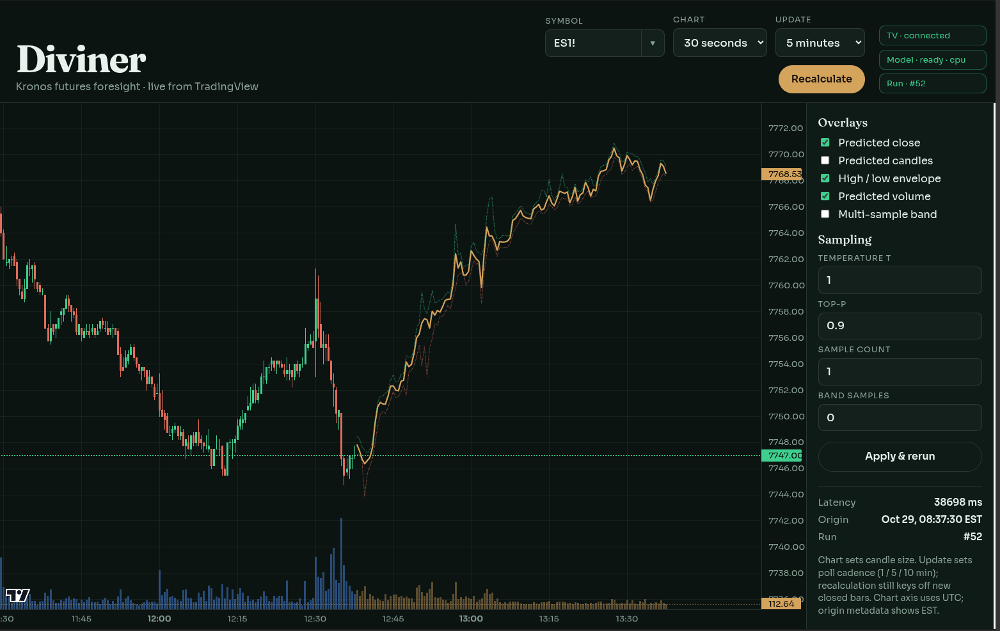

# Diviner

Live [Kronos-base](https://huggingface.co/NeoQuasar/Kronos-base) forecasts for a TradingView chart. A local worker reads OHLCV from **TradingView Desktop** through the [`tradingview-mcp`](https://github.com/tradesdontlie/tradingview-mcp) CLI, runs the model, and serves a FastAPI page with [Lightweight Charts](https://tradingview.github.io/lightweight-charts/).



Diviner does not place orders. It is not affiliated with TradingView. The MIT license covers this repository only and grants no rights to TradingView software, data, or trademarks. 

## What you need

- **TradingView Desktop**, logged into an account that can see the symbols you request, started with Chrome DevTools Protocol on localhost port **9222**.
- **Node.js 18+**
- **Python 3.10+**
- A CUDA GPU is recommended. Kronos-base is comfortable on 16 GB of VRAM. CPU works and is slow.
- Network access on first run, to clone the two upstream repos and download weights from Hugging Face.

## Setup

Clone this repository and run the rest from its root. `Kronos` and `tradingview-mcp` are pinned to the revisions this tree was written against.

```bash
git clone https://github.com/shiyu-coder/Kronos.git Kronos
git -C Kronos checkout 67b630e

git clone https://github.com/tradesdontlie/tradingview-mcp.git tradingview-mcp
git -C tradingview-mcp checkout c05b8f5
cd tradingview-mcp && npm install && cd ..

python3 -m venv .venv
source .venv/bin/activate   # Windows: .venv\Scripts\activate
python -m pip install -U pip
pip install -r requirements.txt

# Install a torch build that matches your driver. cu124 is one current CUDA 12 wheel:
pip install --force-reinstall torch --index-url https://download.pytorch.org/whl/cu124

python scripts/download_models.py
```

`Kronos/` and `tradingview-mcp/` are gitignored. They have to sit next to `diviner/` under those names. `scripts/download_models.py` writes `NeoQuasar/Kronos-base` and `NeoQuasar/Kronos-Tokenizer-base` into `data/models/`. Later startups load those files with `local_files_only=True`. If the directories are missing, Diviner asks Hugging Face for the same model ids instead.

Newer upstream commits may work. If a checkout past those pins breaks the CLI or the `model` import, return to the pins above.

## Connect TradingView

Quit TradingView, then start it with remote debugging bound to localhost. The upstream scripts do that:

```bash
# Linux
./tradingview-mcp/scripts/launch_tv_debug_linux.sh
# macOS
./tradingview-mcp/scripts/launch_tv_debug_mac.sh
# Windows
tradingview-mcp\scripts\launch_tv_debug.bat
```

Or start the desktop binary yourself:

```bash
TradingView --remote-debugging-port=9222
```

The default CDP address is `127.0.0.1:9222` (`TV_CDP_HOST` / `TV_CDP_PORT` in tradingview-mcp). Leave it there. Port 9222 is a debugger attached to your logged-in Desktop session.

Check the bridge before starting Diviner:

```bash
node tradingview-mcp/src/cli/index.js status
```

You want `success: true` and `cdp_connected: true`. Then, with the venv active:

```bash
python scripts/smoke_tv.py
```

That pulls a 400-bar lookback for `ES1!` and `NQ1!` at 1-minute and 5-minute. Failure here means Desktop is not on port 9222, or the chart account cannot see those symbols.

Diviner calls `node tradingview-mcp/src/cli/index.js` directly.

## Run

```bash
source .venv/bin/activate
python -m diviner
```

Open http://127.0.0.1:8080 . The process binds **127.0.0.1** only and has no authentication. Do not expose it, and do not point it at a CDP port that is reachable off the machine.

On startup the worker loads Kronos (`cuda:0` when CUDA is visible, otherwise CPU) and polls TradingView. The header pills show whether Desktop is connected, whether the model loaded, and whether a forecast is running.

## Using the chart

- **Symbol.** Any TradingView symbol, not only futures. `ES1!` and `NQ1!` are seeded into history. Type a symbol and press Enter. The menu lists symbols used before; each row can be removed. Changing symbol forces a new forecast.
- **Chart.** Bar size passed through to Desktop: 10 seconds, 30 seconds, 1 / 5 / 10 / 15 / 30 minutes, 1 hour, 4 hours, or 1 day. Changing it forces a new forecast. The axis is UTC.
- **Update.** How often the worker polls: 1, 5, or 10 minutes. A poll that sees the same closed bar only refreshes candles. A new closed bar triggers another forecast. The default poll is 1 minute. Changing the poll does not by itself rerun the model.
- **Recalculate.** Forces a new forecast on the current symbol and chart.
- **Overlays.** Predicted close (on), predicted candles, high/low envelope (on), predicted volume, and a multi-sample close band. These toggles only change the local chart.
- **Sampling.** Temperature `T` (default 1.0), top-p (0.9), sample count (1), and band samples (0). **Apply & rerun** stores them and forecasts again. Set band samples above 1 to draw a close band: that many paths are combined (the main forecast, then extra single-sample draws), the min and max are plotted, and the mean becomes the predicted close.
- **Draw on TradingView.** Writes the predicted close as trend-line segments on the Desktop chart and replaces the previous Diviner path. Drawing ids are kept in `data/tv_draw_ids.json` on the local machine.
- **Side panel.** Last run id, inference latency, and the origin bar in US Eastern time (labeled EST).

Each forecast uses the last **400 closed bars**. The forming bar is dropped. The model predicts the next **120** bars. Future timestamps follow CME Globex equity-index hours in `America/Chicago`: Sunday 17:00 through Friday 16:00, with the 16:00–17:00 break. Exchange holidays are not skipped. That calendar is what Kronos receives even if you chart a symbol that does not follow Globex.

Forecasts, the bars they were built from, and later actuals land in `data/diviner.db`. The page does not plot accuracy. `GET /api/runs/{id}/accuracy` compares stored forecast closes to actual closes once those bars have been seen (mean absolute error and a direction hit rate). `GET /api/health` reports the CDP connection and model load.

## Tests

```bash
source .venv/bin/activate
pip install -e ".[dev]"
pytest -q
```

The tests do not need TradingView or a GPU.

## Layout

| Path | Role |
| --- | --- |
| `diviner/` | Settings, TradingView CLI client, Globex calendar, Kronos runner, SQLite store, poll worker, FastAPI app |
| `web/` | Chart page |
| `scripts/download_models.py` | Snapshot Kronos weights into `data/models/` |
| `scripts/smoke_tv.py` | Confirm CDP and a short ES/NQ fetch |
| `Kronos/` | Upstream model code. Cloned, not vendored |
| `tradingview-mcp/` | Upstream CDP bridge. Cloned, not vendored |
| `data/` | `diviner.db`, `models/`, and `tv_draw_ids.json` stay local and are gitignored |

## License

[MIT](LICENSE). Copyright (c) 2026 friscoj.

[Kronos](https://github.com/shiyu-coder/Kronos) is MIT, copyright ShiYu. [tradingview-mcp](https://github.com/tradesdontlie/tradingview-mcp) is MIT, copyright tradesdontlie, with its own notice that the license does not cover TradingView. Clone those repositories to receive their license files.
